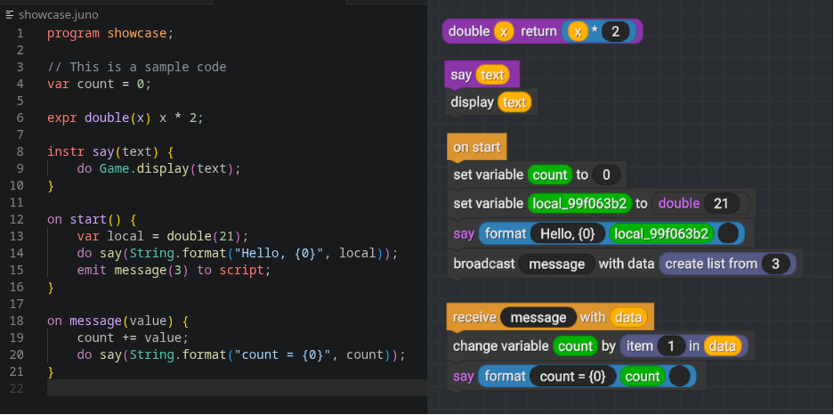

<div align="center">


# JunoPL

**A programming language that compiles to Vizzy**, the visual programming
language used in *Juno New Origins*.

The Juno compiler (`juno-pl`) reads `.juno` source files and emits `.xml`
files that can be loaded directly into the game.



<sub><code>.juno</code> source on the left, the compiled Vizzy on the right</sub>

</div>


## Syntax Highlighting
I suggest using this [extension](https://marketplace.visualstudio.com/items?itemName=Sky1sBloo.juno-pl) for syntax highlighting. Or compile it yourself at this [link](https://github.com/Sky1sBloo/juno-pl-vscode.git).

## Documentation
1. [Api Reference](docs/api-reference.md)
2. [Language Reference](docs/language-reference.md)
3. [Standard Library](docs/stdlib-reference.md)

## Installation
### Requirements
 - C++23
 - CMake (minimum version 4.0.0)
 - Clang++ (with modules support), or MSVC 17.4+ on Windows
 - Ninja (optional; the Visual Studio generator works without it)

### Building
1. Create the build files
```
cmake -B build -DCMAKE_CXX_COMPILER=clang++ -G Ninja
```
2. Build
```
ninja -C build
```
> Alternatively run `build.sh` to run both automatically

### Building on Windows

From a normal terminal — CMake locates Visual Studio automatically:
```
cmake -B build -A x64
cmake --build build --config Release
```
The test suite is built alongside the compiler:
```
ctest --test-dir build -C Release --output-on-failure
```

MSVC 17.4 or newer is required, because that is the first toolset whose C++
module support CMake can drive. The CI workflow builds and tests both the
Linux/Clang and Windows/MSVC configurations.

## CLI usage
```
juno-pl -c <source.juno> [-d <output-dir>]
juno-pl -P [-d <output-dir>]
```

- `-c <file>` — compile this source file
- `-P` — search for `main.juno` in the current directory and then in its
  parents; when both are given, `-c` is used as given
- `-d <dir>` — output directory. Defaults to `outputDir` from `config.json`,
  which is searched for the same way. With neither, the XML is written next
  to the source file.
- `-h`, `--help` — show usage

The output directory is created when it does not exist. The file is named
`<program>.xml` after the `program` declaration in the entry file (the `-c`
file, or `main.juno` with `-P`). Set `outputFile` in `config.json` to use a
different name.

### Configuration

`config.json` is looked for in the current directory and then in each parent
directory, so one project config applies from anywhere inside the project:

```json
{
    "outputDir": "build/xml",
    "outputFile": "custom.xml"
}
```

`outputFile` is optional and is used verbatim as the output file name. When
it is omitted, the compiler writes `<program>.xml`, using the program
declaration from the entry file. `-d` overrides the directory but not the
file name.

A relative `outputDir` is resolved against the directory holding the config
file, not against the directory the compiler runs from. A config that exists
but cannot be parsed, that has no string `outputDir`, or that has a non-string
`outputFile`, is reported as an error rather than silently ignored. `-d`
overrides the configured value but does not suppress that check.

## Example

`hello.juno`:
```
program hello;
import "greeting.juno";

var message = "Hello World!";

on start() {
    do displayGreeting(message);
}
```

`greeting.juno`:
```
program greeting;

instr displayGreeting(text) {
    do Game.display(text);
}
```

`greeting.juno` is resolved relative to `hello.juno`.

Compile:
```
./build/juno-pl -c hello.juno
```

The produced `hello.xml` is ready to import into Juno New Origins by loading the script in the in-game editor. Ensure that the output is on
`%appdata%/LocalLow/Jundroo/SimpleRockets 2/UserData/FlightPrograms/`.

## Modules

| Module | Purpose |
|--------|---------|
| `junopl.lexer` | Tokenizes source text into a token stream |
| `junopl.parser` | Parses tokens into an AST (`RootNode`) |
| `junopl.semantic` | Resolves names, checks arities, reports diagnostics |
| `junopl.compiler` | Lowers the AST to Vizzy XML |
| `junopl.config` | Finds `config.json` and `main.juno` by walking up from the working directory |
| `junopl.filehandler` | File read/write abstraction (`IFileHandler`, `FileHandler`) |
| `junopl.stl` | Standard library function registry (`JunoSTL`) |

See `docs/api-reference.md` for per-module function documentation and
`docs/stdlib-reference.md` for the standard library function catalog.
